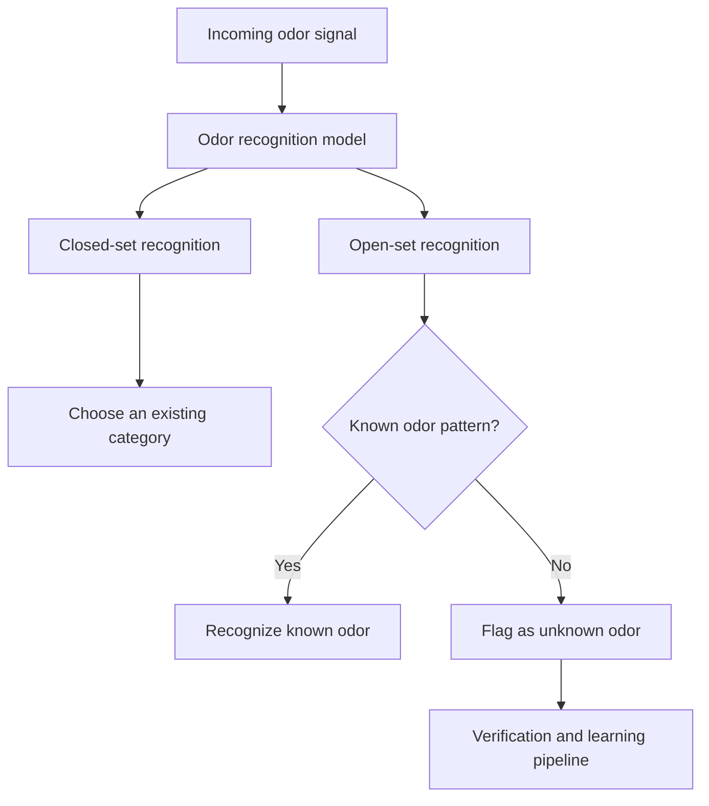
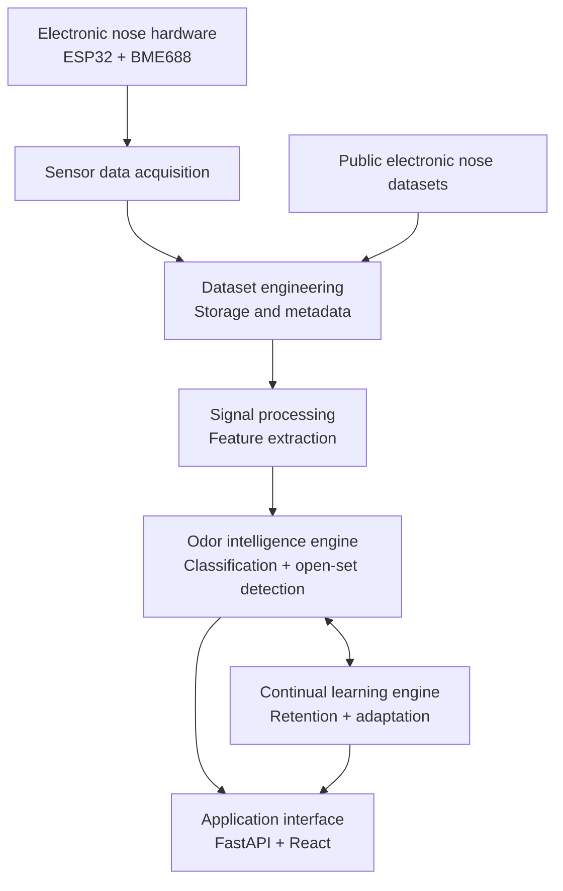
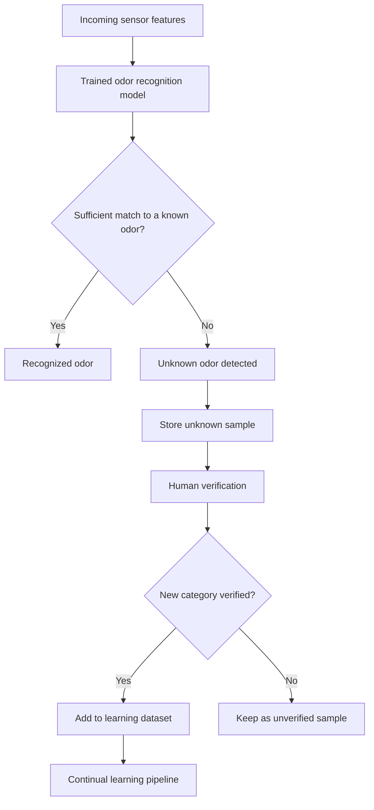
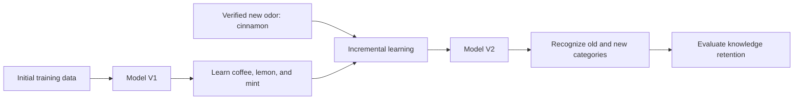
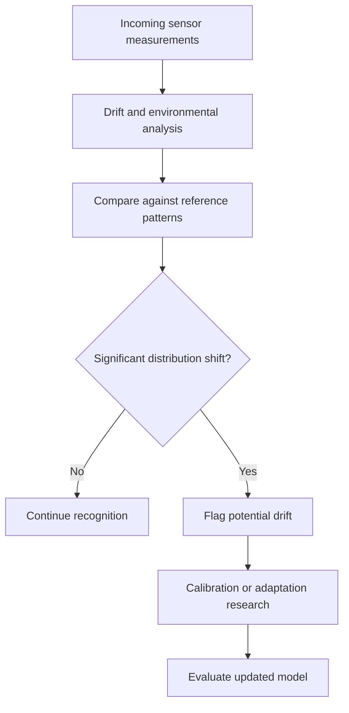

# NoseIQ

### A Self-Learning Electronic Nose for Open-Set Odor Recognition and Continual Learning

**Recognize. Discover. Learn. Adapt.**

NoseIQ is a research and engineering project exploring open-set odor recognition and continual learning using low-cost electronic nose (e-nose) hardware. It aims to recognize known odors, identify unfamiliar patterns, and learn verified new categories while preserving previously acquired knowledge.

The project follows a software-first research approach: initial experiments use public electronic nose datasets, with physical sensor integration planned for a later stage.

## The Problem

Conventional odor classifiers are generally trained on a fixed set of categories. When they encounter an unfamiliar odor, they may still assign it to one of the known categories because they have no explicit mechanism for rejecting unknown patterns.

NoseIQ explores the transition from fixed-category classification to adaptive odor intelligence: recognizing known patterns, flagging unfamiliar ones, and learning new categories only after verification.



## Research Objectives

| Objective | Description |
| --- | --- |
| Known odor recognition | Identify previously learned odor categories. |
| Unknown odor detection | Detect patterns that do not sufficiently match known categories. |
| Incremental learning | Add verified new odor categories without retraining from scratch. |
| Knowledge retention | Reduce forgetting of previously learned categories. |
| Sensor drift adaptation | Account for changes in sensor response over time. |
| Environmental robustness | Investigate variation caused by environmental conditions. |

### Core Research Questions

1. How can unfamiliar odor patterns be distinguished from known categories?
2. How can a model learn new categories without complete retraining?
3. How can previously acquired knowledge be retained during continual learning?
4. How does sensor drift affect odor recognition performance?
5. How can environmental variation be accounted for in odor classification?

## Proposed System Architecture



| Layer | Responsibility |
| --- | --- |
| Sensor and hardware | Collect physical sensor measurements; planned hardware includes an ESP32 and Bosch BME688. |
| Data acquisition | Collect, organize, and transmit sensor measurements. |
| Dataset engineering | Ingest, validate, preprocess, and prepare datasets and metadata. |
| Signal processing | Transform raw measurements into useful numerical features. |
| Odor intelligence | Provide odor classification and open-set or unknown-odor detection. |
| Continual learning | Incorporate verified categories while evaluating knowledge retention and adaptation. |
| Application | Provide a future interface through a FastAPI backend and React frontend. |

> This is the proposed architecture. Not all components are implemented or connected yet.

## Data Processing Pipeline


| Stage | Responsibility |
| --- | --- |
| Data ingestion | Load public datasets or acquired sensor measurements. |
| Data validation | Check for missing values, invalid records, and inconsistencies. |
| Exploratory analysis | Understand sensor distributions and odor patterns. |
| Preprocessing | Apply appropriate filtering, normalization, and transformations. |
| Feature extraction | Create useful representations from sensor measurements. |
| Dataset preparation | Prepare training, validation, and testing data. |
| Model evaluation | Measure classification and unknown-detection performance. |

The pipeline is intended to support reproducible experiments and future hardware integration.

## Open-Set Odor Recognition

The system should reject unfamiliar patterns instead of forcing every input into a known category. A proposed workflow is:



Research considerations include recognition confidence, decision thresholds, feature-space representations, and the trade-off between false acceptance and false rejection of unknown samples.

## Continual Learning

When a model learns a new category, it can lose the ability to recognize previously learned categories. NoseIQ will explore incremental class learning, replay-based approaches, catastrophic forgetting, and post-update knowledge-retention evaluation.



## Sensor Drift and Environmental Adaptation

Electronic nose sensors can respond differently over time to similar odor conditions. Temperature, humidity, and other environmental factors can also influence measurements. Research areas include sensor response variation, baseline normalization, feature distribution changes, and model adaptation strategies.



## Technology Stack

| Category | Technology | Purpose |
| --- | --- | --- |
| Programming | Python | Core development and experimentation. |
| Classical machine learning | scikit-learn | Baseline models and evaluation. |
| Deep learning | PyTorch | Neural network experimentation. |
| Data analysis | NumPy, pandas | Numerical computing and data manipulation. |
| Visualization | Matplotlib, Plotly | Experimental visualization. |
| Notebook environment | Jupyter | Exploratory analysis and research experiments. |
| Dataset access | `ucimlrepo`, `huggingface_hub` | Access public dataset sources. |
| Hardware | ESP32, Bosch BME688 | Planned microcontroller-based sensing. |
| Backend and frontend | FastAPI, React | Planned application interface. |
| Version control | Git, GitHub | Source control and collaboration. |

## Repository Structure

```text
NoseIQ/
├── dashboard/                 # Dashboard application
├── data/
│   ├── metadata/
│   ├── predictions/
│   ├── processed/
│   └── raw/
├── experiments/
│   ├── configs/
│   └── results/
├── firmware/
│   └── esp32/
├── models/
│   ├── configs/
│   └── trained/
├── notebooks/
├── research/
├── src/
│   ├── api/
│   ├── data/
│   ├── evaluation/
│   ├── learning/
│   ├── models/
│   ├── preprocessing/
│   └── utils/
├── tests/
├── config.yaml
└── requirements.txt
```

The modules are separated to support experimentation, reproducibility, and future hardware integration. Some directories are planned extension points and may not yet contain implemented components.

## Getting Started

The project uses a Python virtual environment. From the repository root, create and activate it, then install the dependencies:

```powershell
py -3.11 -m venv .venv
Set-ExecutionPolicy -Scope Process -ExecutionPolicy RemoteSigned
.\.venv\Scripts\Activate.ps1
python -m pip install -r requirements.txt
```

The execution-policy command applies only to the current PowerShell process. If the virtual environment already exists, skip the `venv` creation command. Activating the environment does not install packages; run the `pip install` command when setting it up.

## Development Roadmap

| Phase | Focus area | Status |
| --- | --- | --- |
| 0 | Environment setup and software-first development | In progress |
| 1 | Public dataset collection and exploration | Planned |
| 2 | Signal preprocessing and feature engineering | Planned |
| 3 | Baseline odor classification | Planned |
| 4 | Open-set odor recognition | Planned |
| 5 | Continual learning and knowledge retention | Planned |
| 6 | Sensor drift adaptation | Planned |
| 7 | ESP32 and BME688 hardware integration | Planned |
| 8 | API, dashboard, and end-to-end evaluation | Planned |

## Evaluation

Evaluation will extend beyond conventional classification accuracy.

| Research area | Evaluation focus |
| --- | --- |
| Classification | Accuracy, precision, recall, and F1 score. |
| Open-set recognition | Unknown detection and false acceptance. |
| Continual learning | Forgetting and knowledge retention. |
| Drift adaptation | Performance under distribution changes. |
| Robustness | Performance under environmental variation. |
| System performance | Inference latency and resource requirements. |

Evaluation methods and metrics will be refined as experiments develop.

## Research Disclaimer

NoseIQ is currently in its software-first development stage, and initial experiments are intended to use publicly available electronic nose datasets.

**Results from public datasets must not be interpreted as validation of a physical Bosch BME688 implementation.** Hardware validation requires independent experiments with the actual sensor, controlled odor exposure, documented acquisition conditions, and repeatable evaluation procedures.

## Research Vision

The long-term vision is an electronic nose that is not limited to a fixed set of predefined odor categories, but can progressively build and maintain its odor knowledge through verified learning experiences.

NoseIQ brings together electronic nose sensing, machine learning, open-set recognition, continual learning, sensor adaptation, and embedded systems.

> NoseIQ: An electronic nose that doesn't just recognize what it knows, but learns to recognize what it doesn't.

---

*Project type: Independent research and engineering project*  
*Development approach: Software-first, hardware-integrated*  
*Primary research areas: Open-set recognition, continual learning, and electronic nose systems*
